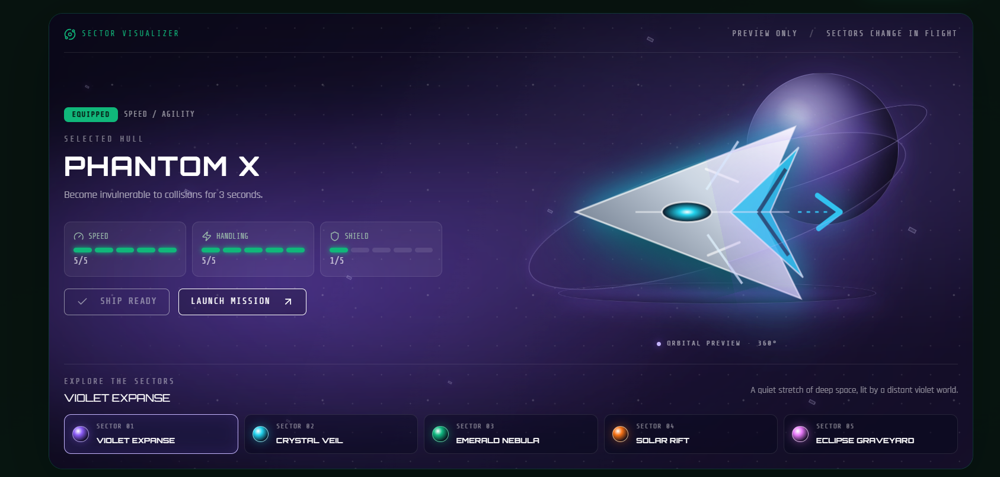
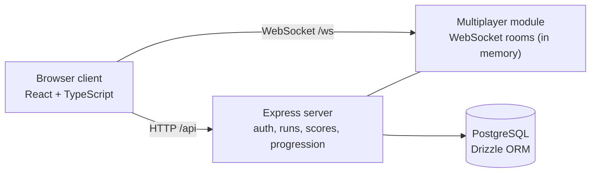

# Space Escape

A real-time multiplayer space survival game. Dodge obstacles and chase the highest score while the server keeps authority over runs and scores.

**Play it: https://space-escape.onrender.com/**



## Features

- Real-time multiplayer rooms (up to 4 players) over WebSockets, with spectator mode and final rankings
- Server-authoritative runs: the server issues runs, tracks heartbeats and calculates the score, so clients cannot submit their own
- Accounts, persistent sessions and a PostgreSQL leaderboard
- Hangar with unlockable ships, abilities and progression
- Automated tests for multiplayer and score authority, run in CI

## Architecture



- `client/` React app (pages for the game, hangar, multiplayer, leaderboard)
- `server/` Express API, run and score authority (`run-authority.ts`), multiplayer rooms (`multiplayer.ts`)
- `shared/` schema, API routes and ship data used by both sides

## Run locally

```sh
npm ci
npm run db:push   # needs DATABASE_URL
npm run dev
npm test
```

## Performance

Load-tested on one CPU core (2 vCPU test machine, server and load generator on separate cores):

| Measure | Result |
| --- | --- |
| p95 message latency under 100 ms | up to about 363-375 concurrent 4-player rooms (about 1,450-1,500 clients) |
| p50 latency, one room | 0.2 ms |
| Server CPU per delivered message | about 6 µs |
| Idle connections | 16,000 held in 144 MB |
| 10-minute runs at 263 and 188 rooms | no dropped connections |

Numbers depend on the machine. Method, full results and how to reproduce: [benchmarks/multiplayer](benchmarks/multiplayer).

## Tech stack

React, TypeScript, Node.js, Express, WebSockets, PostgreSQL, Drizzle ORM, Tailwind CSS
