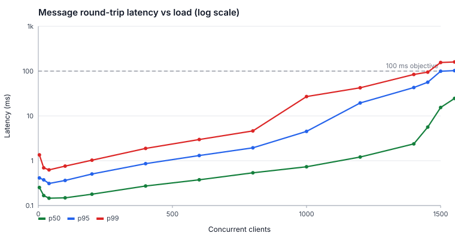
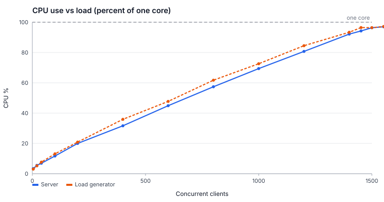
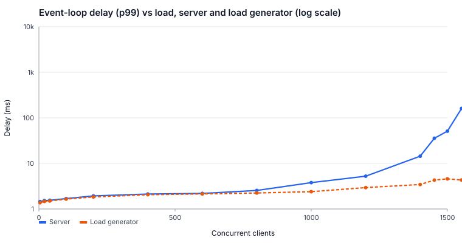
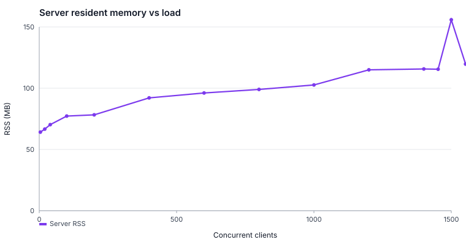
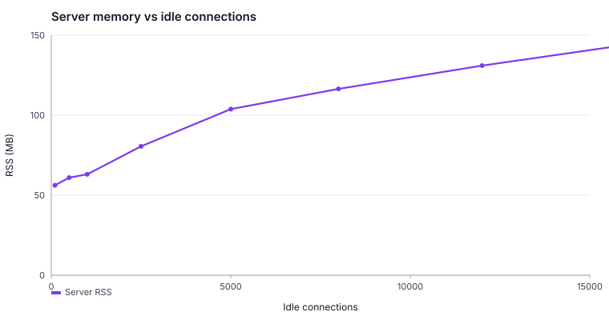
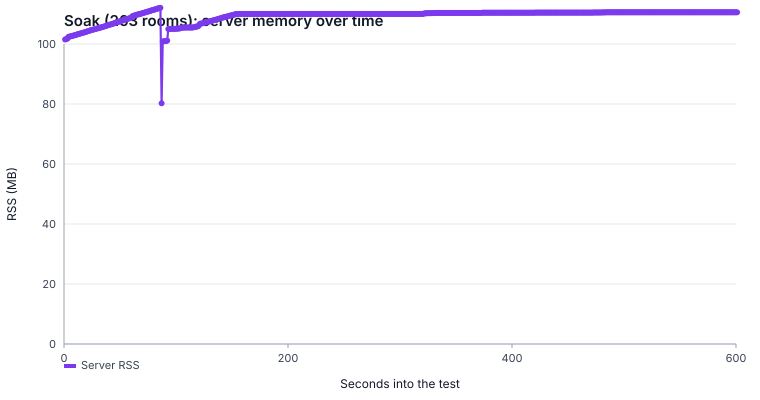
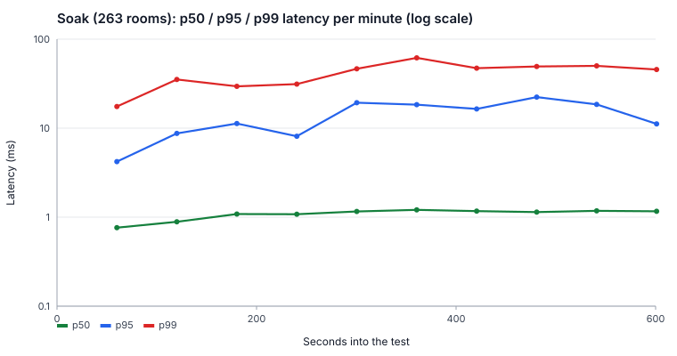
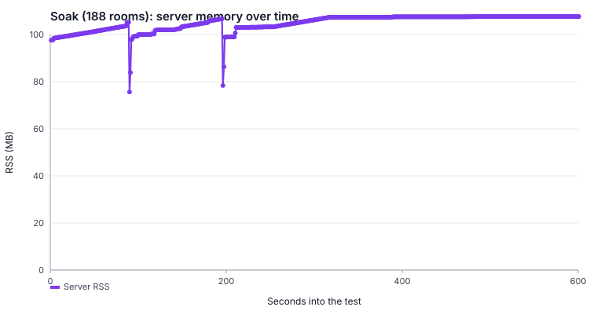
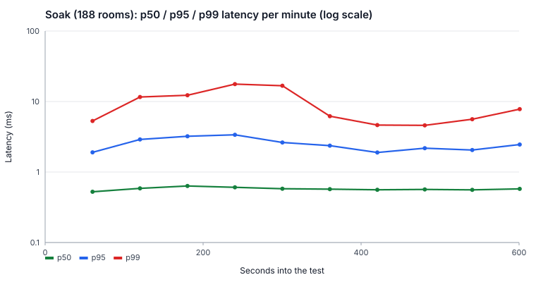

# ASTRODODGE multiplayer scalability report

Generated from the raw data in this directory by `benchmarks/multiplayer/report.ts`. Nothing here is hand-edited: delete this file and run the generator to reproduce it.

- **Run date (UTC):** 2026-10-28T03:54:32.477Z
- **Code under test:** commit `82c341d631` (working tree had uncommitted benchmark files), `server/multiplayer.ts` served by Node v22.23.4, ws 8.18.0
- **Machine:** 2 vCPU Intel(R) Xeon(R) Processor @ 2.30GHz, 8028 MB RAM, linux x64, kernel 6.18.44-fc-v180 (virtual machine, hypervisor: unknown)
- **Pinning:** server on CPU 0, load generator on CPU 1, over the loopback interface

## Headline results

- **Capacity:** one server process (one CPU core) held the **p95 round-trip latency under 100 ms at 363 concurrent 4-player rooms (1452 simultaneously flying clients) or more** in each of 3 independent ramp runs. The highest level that passed in each run was 375, 375, 363 rooms, so the breaking point on this machine is about 363–375 rooms (1452–1500 clients). The first level above that where any run did not pass was 375 rooms (1500 clients; 2 pass, 1 slo-breach).
- **Latency at 363 rooms** (1 run at this level): p50 5.6 ms, p95 56.5 ms, p99 95.0 ms.
- **Uncontended latency:** one room on an idle server has a median round trip of 0.21 ms (p99 1.26 ms).
- **Failure mode:** at 388 rooms the single-threaded server's own event loop stalls (server event-loop delay p99 161 ms) with CPU at 97% of one core, so messages queue and latency climbs. Across the 8 runs at 388 rooms and above there were no dropped connections, socket errors or wrongly eliminated players: the server slows down rather than failing.
- **Cost per message:** about 6.3 µs of server CPU per delivered message, and each client receives about 108 messages per second (the 15 Hz position stream from 4 players is 60 messages per second; the rest are score-change broadcasts).
- **Memory:** server resident memory grew from 64 MB at 4 clients to 116 MB at 1452 clients.
- **Idle connections:** 16000 lobby connections were held with 144 MB resident (about 5.8 kB per additional connection) and 0.10% idle CPU; no failures up to the largest size tested.
- **Sustained load (263 rooms, 1052 clients, 70% of the median breaking point, 10 minutes):** 0 dropped connections, errors or wrongful eliminations. 10 of 10 one-minute windows kept p95 within 100 ms (minute-to-minute p95 ranged 4.2–22.3 ms), trend +1.28 ± 0.53 ms per minute (1 standard error): a drift distinguishable from the noise (about 11.5 ms over the run). Memory went from 102 MB to 111 MB (0.08 MB/min over the second half, after warm-up). Garbage collection took 1.56% of wall time on average.
- **Sustained load (188 rooms, 752 clients, 50% of the median breaking point, 10 minutes):** 0 dropped connections, errors or wrongful eliminations. 10 of 10 one-minute windows kept p95 within 100 ms (minute-to-minute p95 ranged 1.9–3.4 ms), trend -0.07 ± 0.06 ms per minute (1 standard error): no drift distinguishable from the minute-to-minute noise. Memory went from 98 MB to 108 MB (0.12 MB/min over the second half, after warm-up). Garbage collection took 0.94% of wall time on average.
- **Measurement accuracy:** with a known delay of 20–100 ms injected between client and server, the tool's readings rise with slope 1.0006 (1.0000 is exact; within the 1% standard) plus a constant offset of 0.40 ms, which comes from the test relay itself.

## What was tested

Each simulated pilot behaves like the real game client: it opens a WebSocket, joins a room of 4, readies up, and then sends a position update about 15 times per second (the real client sends one roughly every 66 ms while flying). The server answers each update by broadcasting that player's state to everyone in the room, and a 250 ms server tick scores rooms and eliminates silent players. All pilots stay alive for the whole measurement, which is the worst case for the server (real runs end when a ship crashes).

**Latency** is the full round trip of a single message: send, server queueing and processing, broadcast, receive. Each position update carries a tag that comes back in the server's broadcast, so every message is timed individually using one clock. Percentiles are exact over every sample (nearest-rank), not estimates. See [METHODOLOGY.md](../../METHODOLOGY.md) for the full method and its limits.

A load level **passes** when: p95 latency ≤ 100 ms; no pilot is wrongly eliminated; no connection drops or socket errors; every room starts; at least 95% of messages complete a measured round trip; and the load generator itself is healthy (its event loop stays responsive, so it is not distorting results). The **breaking point** is the highest tested load level that passes, with the gap to the first failing level narrowed by bisection to about 5%.

## Load ramp: concurrent rooms

Every row is a fresh server process. Latency and CPU are medians across the 3 independent ramp runs (p95 min–max shown to expose run-to-run variation). Server CPU is a percentage of one core and includes about 1.9 percentage points of constant overhead from the benchmark's own event-loop monitor (measured below; the production server does not have it).

| Rooms | Clients | p50 ms | p95 ms | p95 min–max | p99 ms | max ms | Server CPU | Server RSS MB | Server loop p99 ms | Server GC % | Verdict |
| --- | --- | --- | --- | --- | --- | --- | --- | --- | --- | --- | --- |
| 1 | 4 | 0.25 | 0.4 | 0.4–0.6 | 1.3 | 7 | 3% | 64 | 1.5 | 0.10 | 3 pass |
| 5 | 20 | 0.17 | 0.4 | 0.3–0.4 | 0.7 | 6 | 5% | 67 | 1.5 | 0.07 | 3 pass |
| 10 | 40 | 0.15 | 0.3 | 0.3–0.3 | 0.6 | 5 | 7% | 70 | 1.6 | 0.10 | 3 pass |
| 25 | 100 | 0.15 | 0.4 | 0.4–0.4 | 0.8 | 6 | 12% | 77 | 1.7 | 0.19 | 3 pass |
| 50 | 200 | 0.18 | 0.5 | 0.5–0.6 | 1.0 | 9 | 20% | 78 | 1.9 | 0.31 | 3 pass |
| 100 | 400 | 0.27 | 0.9 | 0.7–0.9 | 1.9 | 6 | 32% | 92 | 2.1 | 0.38 | 3 pass |
| 150 | 600 | 0.38 | 1.3 | 1.2–1.3 | 3.0 | 26 | 45% | 96 | 2.2 | 0.69 | 3 pass |
| 200 | 800 | 0.54 | 1.9 | 1.8–2.5 | 4.6 | 27 | 57% | 99 | 2.6 | 1.04 | 3 pass |
| 250 | 1000 | 0.73 | 4.5 | 4.1–5.2 | 27.0 | 42 | 69% | 103 | 3.8 | 1.35 | 3 pass |
| 300 | 1200 | 1.21 | 19.5 | 12.4–21.0 | 42.5 | 101 | 81% | 115 | 5.3 | 2.13 | 3 pass |
| 350 | 1400 | 2.38 | 43.0 | 32.5–46.1 | 84.3 | 146 | 92% | 116 | 14.4 | 3.04 | 3 pass |
| 363 | 1452 | 5.63 | 56.5 | 56.5–56.5 | 95.0 | 144 | 94% | 116 | 35.6 | 3.11 | 1 pass |
| 375 | 1500 | 15.44 | 99.3 | 90.2–101.4 | 155.5 | 239 | 96% | 156 | 51.1 | 3.49 | 2 pass, 1 slo-breach |
| 388 | 1552 | 24.58 | 102.6 | 95.6–109.6 | 160.0 | 306 | 97% | 120 | 161.0 | 3.50 | 1 generator-limited, 1 slo-breach |
| 400 | 1600 | 29.93 | 110.4 | 92.4–121.2 | 175.9 | 262 | 97% | 119 | 95.4 | 3.67 | 3 generator-limited |
| 450 | 1800 | 77.97 | 164.2 | 158.3–178.7 | 211.0 | 312 | 96% | 121 | 3984.6 | 3.71 | 3 generator-limited |

Server GC % is the share of the measured window the server spent in garbage collection.

Levels that are not round numbers exist because each run narrowed down its own breaking point by bisection, so they were only tested in the runs whose bisection reached them; the Verdict column shows how many runs each level has.

A *generator-limited* run means the load generator, not the server, was saturated (its CPU above 97% or its event loop more than 10 ms behind), so that run's latency is not a valid measurement of the server and is not counted as a pass or a server failure. Latency columns are medians over all runs at that level, including such runs.

### What happened at the levels that did not pass

Counts are summed over every run at that level. Failed room starts are rooms whose four players could not all join and ready up within the setup timeout, which happens when the server's event loop is stalled for seconds at a time.

| Rooms | Verdicts | Failed room starts | Dropped connections | Socket errors | Wrongly eliminated |
| --- | --- | --- | --- | --- | --- |
| 375 | 2 pass, 1 slo-breach | 0 | 0 | 0 | 0 |
| 388 | 1 generator-limited, 1 slo-breach | 0 | 0 | 0 | 0 |
| 400 | 3 generator-limited | 0 | 0 | 0 | 0 |
| 450 | 3 generator-limited | 0 | 0 | 0 | 0 |







### Is the server or the test tool the limit?

The load generator is one Node process and does about as much work as the server (it receives every broadcast), so near the limit both approach a full core. The server's own event-loop delay is measured inside the server process and does not depend on the generator, so it shows which side is actually falling behind.

| Rooms | Server CPU | Server loop p99 ms | Server loop max ms | Generator CPU | Generator loop p99 ms |
| --- | --- | --- | --- | --- | --- |
| 200 | 57% | 2.6 | 22 | 62% | 2.2 |
| 250 | 69% | 3.8 | 45 | 73% | 2.4 |
| 300 | 81% | 5.3 | 75 | 85% | 3.0 |
| 350 | 92% | 14.4 | 241 | 93% | 3.4 |
| 363 | 94% | 35.6 | 195 | 96% | 4.3 |
| 375 | 96% | 51.1 | 611 | 96% | 4.6 |
| 388 | 97% | 161.0 | 830 | 97% | 4.3 |
| 400 | 97% | 95.4 | 1245 | 98% | 5.2 |
| 450 | 96% | 3984.6 | 3985 | 98% | 6.8 |

At 388 rooms the server's event loop is a median of 161 ms behind at p99 while the generator's is 4.3 ms: the delay is being added by the server. Below that, the two sides rise together, and the exact level where p95 crosses 100 ms carries the uncertainty described in the limitations.



### Breaking point per run

| Run | Last passing rooms | Last passing clients | First non-passing rooms | Why it did not pass |
| --- | --- | --- | --- | --- |
| 1 | 375 | 1500 | 388 | load generator saturated (CPU 98%, event-loop p99 4.8 ms); results are not valid for the server |
| 2 | 375 | 1500 | 388 | p95 109.6 ms exceeds the 100 ms objective |
| 3 | 363 | 1452 | 375 | p95 101.4 ms exceeds the 100 ms objective |

## Uncontended baseline: one room

| Run | Samples | p50 ms | p95 ms | p99 ms | max ms | Server CPU | Server RSS MB |
| --- | --- | --- | --- | --- | --- | --- | --- |
| 1 | 1802 | 0.25 | 0.48 | 1.77 | 6.0 | 4% | 65 |
| 2 | 1801 | 0.21 | 0.42 | 1.26 | 4.7 | 3% | 64 |
| 3 | 1800 | 0.21 | 0.38 | 0.56 | 8.8 | 3% | 64 |

## Idle connection capacity

Pilots connected and waiting in lobbies (4 per room), nobody flying. Measures what a connection costs when nothing is happening. Each size is a fresh server process, so "kB / connection" at small sizes includes one-off warm-up memory; the marginal cost per additional connection (least-squares slope of memory against connections across all sizes) is **5.8 kB**.

| Connections | Connected | Failures | Connect time s | Server RSS MB | kB / connection | Idle CPU | Server open files |
| --- | --- | --- | --- | --- | --- | --- | --- |
| 100 | 100 | 0 | 0.2 | 56 | 61.8 | 0.30% | 122 |
| 500 | 500 | 0 | 0.7 | 61 | 22.4 | 0.30% | 522 |
| 1000 | 1000 | 0 | 1.3 | 63 | 13.2 | 0.40% | 1022 |
| 2500 | 2500 | 0 | 3.3 | 81 | 12.4 | 0.10% | 2522 |
| 5000 | 5000 | 0 | 6.5 | 104 | 11.0 | 0.00% | 5022 |
| 8000 | 8000 | 0 | 10.4 | 116 | 8.5 | 0.10% | 8022 |
| 12000 | 12000 | 0 | 15.7 | 131 | 6.9 | 0.20% | 12022 |
| 16000 | 16000 | 0 | 20.8 | 144 | 6.0 | 0.10% | 16022 |



## Soak test: 263 rooms

263 rooms (1052 clients), 70% of the median breaking point, for 10 minutes on one server process.

| Metric | Value |
| --- | --- |
| Memory at start / end | 102 MB / 111 MB |
| Memory trend, whole run / second half (least squares) | 0.49 / 0.08 MB per minute (the whole-run figure includes warm-up growth) |
| p95 latency per minute: lowest / median / highest | 4.2 / 13.9 / 22.3 ms |
| Minutes with p95 within the objective | 10 of 10 (objective 100 ms) |
| p95 latency, median of first half / second half | 8.7 ms / 18.4 ms |
| p95 trend (least squares over the minutes) | +1.28 ± 0.53 ms per minute (1 standard error) |
| Whole-run p50 / p95 / p99 / max | 1.09 / 14.0 / 42.7 / 152 ms |
| Server CPU (mean) | 79% |
| Garbage collection, share of wall time: mean / highest minute | 1.56% / 1.68% |
| Correlation of per-minute p95 with per-minute GC share | r = 0.49 over 9 minutes (GC time does not explain the minute-to-minute latency) |
| Wrongly eliminated / dropped / errors | 0 / 0 / 0 |

Latency per one-minute window. The minute-to-minute spread can be large because a single-threaded server running near its limit queues messages in bursts, so no single minute should be compared with another in isolation; the trend line above uses all of them. GC % is the share of that minute the server spent in garbage collection (the first minute has no earlier snapshot to subtract).

| Minute | Samples | p50 ms | p95 ms | p99 ms | max ms | Server CPU | Server RSS MB | Heap MB | GC % |
| --- | --- | --- | --- | --- | --- | --- | --- | --- | --- |
| 1 | 947367 | 0.76 | 4.2 | 17.5 | 92 | 70% | 105.3 | 30.8 | n/a |
| 2 | 948487 | 0.89 | 8.7 | 35.3 | 98 | 75% | 106.9 | 20.0 | 1.43 |
| 3 | 948697 | 1.08 | 11.3 | 29.5 | 108 | 80% | 109.0 | 20.2 | 1.42 |
| 4 | 948524 | 1.08 | 8.1 | 31.3 | 132 | 80% | 110.0 | 12.2 | 1.46 |
| 5 | 948487 | 1.16 | 19.3 | 46.4 | 119 | 81% | 110.0 | 16.4 | 1.55 |
| 6 | 948374 | 1.21 | 18.4 | 61.7 | 140 | 82% | 110.2 | 16.7 | 1.67 |
| 7 | 948288 | 1.17 | 16.5 | 47.2 | 152 | 81% | 110.4 | 15.7 | 1.65 |
| 8 | 948468 | 1.14 | 22.3 | 49.3 | 135 | 81% | 110.5 | 16.3 | 1.55 |
| 9 | 948392 | 1.18 | 18.5 | 50.1 | 132 | 81% | 110.6 | 23.4 | 1.61 |
| 10 | 948424 | 1.16 | 11.2 | 45.6 | 118 | 81% | 110.6 | 25.4 | 1.68 |





## Soak test: 188 rooms

188 rooms (752 clients), 50% of the median breaking point, for 10 minutes on one server process.

| Metric | Value |
| --- | --- |
| Memory at start / end | 98 MB / 108 MB |
| Memory trend, whole run / second half (least squares) | 0.94 / 0.12 MB per minute (the whole-run figure includes warm-up growth) |
| p95 latency per minute: lowest / median / highest | 1.9 / 2.4 / 3.4 ms |
| Minutes with p95 within the objective | 10 of 10 (objective 100 ms) |
| p95 latency, median of first half / second half | 2.9 ms / 2.2 ms |
| p95 trend (least squares over the minutes) | -0.07 ± 0.06 ms per minute (1 standard error) |
| Whole-run p50 / p95 / p99 / max | 0.58 / 2.5 / 8.4 / 93 ms |
| Server CPU (mean) | 60% |
| Garbage collection, share of wall time: mean / highest minute | 0.94% / 1.12% |
| Correlation of per-minute p95 with per-minute GC share | r = 0.92 over 9 minutes (latency rises and falls with GC time, consistent with GC contributing) |
| Wrongly eliminated / dropped / errors | 0 / 0 / 0 |

Latency per one-minute window. The minute-to-minute spread can be large because a single-threaded server running near its limit queues messages in bursts, so no single minute should be compared with another in isolation; the trend line above uses all of them. GC % is the share of that minute the server spent in garbage collection (the first minute has no earlier snapshot to subtract).

| Minute | Samples | p50 ms | p95 ms | p99 ms | max ms | Server CPU | Server RSS MB | Heap MB | GC % |
| --- | --- | --- | --- | --- | --- | --- | --- | --- | --- |
| 1 | 677279 | 0.52 | 1.9 | 5.3 | 58 | 55% | 100.0 | 16.9 | n/a |
| 2 | 677778 | 0.59 | 2.9 | 11.6 | 91 | 60% | 100.8 | 17.6 | 1.12 |
| 3 | 678001 | 0.63 | 3.2 | 12.3 | 88 | 63% | 103.2 | 20.4 | 1.05 |
| 4 | 677765 | 0.61 | 3.4 | 17.6 | 72 | 62% | 102.4 | 13.2 | 1.09 |
| 5 | 677720 | 0.58 | 2.6 | 16.7 | 93 | 60% | 104.4 | 20.5 | 0.93 |
| 6 | 677723 | 0.57 | 2.4 | 6.2 | 71 | 60% | 107.1 | 12.3 | 0.89 |
| 7 | 677652 | 0.56 | 1.9 | 4.6 | 84 | 59% | 107.4 | 14.8 | 0.80 |
| 8 | 677695 | 0.57 | 2.2 | 4.6 | 69 | 60% | 107.5 | 11.4 | 0.81 |
| 9 | 677680 | 0.56 | 2.1 | 5.6 | 68 | 58% | 107.6 | 26.7 | 0.87 |
| 10 | 677739 | 0.58 | 2.5 | 7.8 | 66 | 60% | 107.6 | 14.1 | 0.93 |





## Cross-check: isolated server vs full production server

The ramp uses the multiplayer module on its own (no Express, sessions or database), because the WebSocket path does not use them. To check that this does not flatter the results, 263 rooms were run alternately against that harness and against the real production bundle (`dist/index.cjs`, started exactly as on Render, with a dummy database address that is never contacted).

| Server | Runs | p50 ms | p95 ms | p95 min–max | p99 ms | Server CPU | Server RSS MB |
| --- | --- | --- | --- | --- | --- | --- | --- |
| multiplayer module only (with event-loop monitor) | 5 | 0.77 | 6.4 | 3.9–15.3 | 26.3 | 71% | 104 |
| full production bundle | 5 | 0.77 | 3.9 | 3.3–9.9 | 21.3 | 70% | 112 |

Comparison by exact permutation test (the share of all ways of re-splitting the runs into two groups that differ at least as much as the observed split; no distribution assumed):

- p95 latency: median 6.4 ms (isolated module) vs 3.9 ms (production), -39%; exact permutation test over all 10 runs p = 0.476, not distinguishable from run-to-run variation.
- Server CPU (isolated module's figure has the event-loop monitor's measured 1.9 percentage points removed): median 68.6 % (isolated module) vs 69.5 % (production), +1%; exact permutation test over all 10 runs p = 0.540, not distinguishable from run-to-run variation.
- Memory: production resident memory is 112 MB against 104 MB for the isolated module; the difference is the Express, session and database-client code that the bundle loads.

Where the test finds no difference, the ramp's capacity figures for the isolated module carry over to the production bundle within the run-to-run spread; where it finds one, the figures should be adjusted by about the stated percentage.

## Measurement calibration

A relay that adds a fixed delay in each direction was placed between the load generator and the server. If the tool measures time correctly, the readings must rise one millisecond for every millisecond injected (slope 1). Any constant offset is the relay's own cost (two extra hops, and Node timers that cannot fire sooner than 1 ms), so it is reported separately instead of being counted as measurement error. The 0 ms row is shown for reference but not fitted, because a 0 ms timer is rounded up to 1 ms.

| Injected round trip ms | Measured p50 ms | Measured p95 ms | Reading minus injected, ms |
| --- | --- | --- | --- |
| 0 | 2.59 | 3.05 | 2.59 |
| 20 | 20.36 | 21.79 | 0.36 |
| 50 | 50.51 | 51.41 | 0.51 |
| 100 | 100.43 | 101.59 | 0.43 |

Least-squares fit of the 20, 50 and 100 ms readings: **slope 1.0006**, constant offset 0.40 ms. The standard is a slope within 1% of 1: **met**. For comparison, the same measurement without any relay (the uncontended baseline) reads about 0.21 ms.

## Measurement overhead

The load-test server reports its own event-loop delay using Node's `monitorEventLoopDelay` with a 1 ms timer. That timer wakes the process 1000 times a second, so it costs CPU even when nothing is happening. An idle server was measured with and without it (3 alternating rounds of 20 s):

| Server | Idle CPU (median) |
| --- | --- |
| monitor off | 0.10% of one core |
| monitor on (used in ramp, soak, baseline) | 2.05% of one core |
| overhead | 1.95 percentage points |

The idle-connection test runs with the monitor off, so its idle CPU is not affected, and the production bundle in the cross-check has no monitor either.

## Limitations and how to read these numbers

- **These are measurements of this machine, not of your Render instance.** Capacity scales with single-core speed. A fractional-CPU or throttled plan will be lower, a faster one higher. The suite is designed to be re-run on the machine you care about (see the README in this folder); nothing here should be quoted as a guarantee for production.
- **Loopback network.** There is no internet latency, TLS or reverse proxy in these round-trip times. A real player adds their own network delay on top, and Render's proxy adds its own overhead.
- **Synthetic players.** Pilots are Node processes sending a fixed-rate position stream and never crash. Real sessions are shorter and burstier, and browsers add their own timing, so treat the figures as an upper bound on per-room load, not a forecast of real traffic.
- **One server process.** The server is single-threaded and keeps all rooms in memory, so capacity is per process and rooms cannot be spread across instances without changes to the design.
- **Load generator shares the machine.** Server and generator run on separate pinned cores of the same virtual machine. The report checks that the generator's event loop stays responsive, but noisy neighbours on the host can still add variation; the per-run CPU steal and the min–max columns show how large it was.
- **The breaking point is a range, not an exact number.** The generator and the server both approach a full core near the limit, so some runs there are discarded as generator-limited. The reported capacity is the highest level at which every validity condition held; the server's own event-loop delay (see the section above) shows where it genuinely stalls, and the true limit lies between the two.
- **The idle-connection test stopped by design.** It was run up to 16,000 connections because the test machine allows about 20,000 open files per process; no limit was reached, so the real ceiling is unknown and higher than the largest size shown.
- **Only the multiplayer WebSocket path was measured.** Login, score submission, leaderboard and static file serving were not load tested here, and they share the same Node event loop in production.

## Reproduce

```sh
npm ci
benchmarks/multiplayer/run-all.sh benchmarks/multiplayer/results/2026-10-28-official   # about 50 minutes; keep the machine idle
```

Individual scenarios and every option are documented in [README.md](../../README.md) next to the scripts. Raw data (every step, with per-second timelines) is in the JSON files in this directory.
